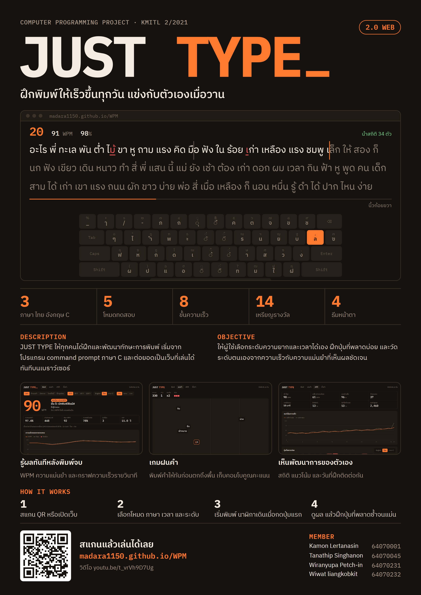

# ⌨️ JUST TYPE ⌨️
> ✨ Computer Programming Project KMITL 2/2021 ✨

## 🚀 JUST TYPE 2.0 (เวอร์ชันเว็บ)
ต่อยอดจากโปรแกรม command prompt ภาษา C ([`zaza.c`](zaza.c)) มาเป็นเว็บแอปในโฟลเดอร์ [`docs/`](docs/) ไม่มี dependency และไม่ต้อง build

| หมวด | ฟีเจอร์ |
|-----|-----|
| โหมดทดสอบ | จับเวลา 15–120 วินาที, จำนวนคำ, ข้อความ, โจทย์ประจำวัน (ข้อความเดียวกันทุกเครื่อง), ฝึกจุดอ่อน (เลือกคำจากปุ่มที่พลาดบ่อย) |
| ภาษา | ไทย, English, โค้ดภาษา C พร้อมระดับ ง่าย/กลาง/ยาก |
| เกม | ฝนคำ: พิมพ์คำให้ทันก่อนตกถึงพื้น มีคอมโบ ด่าน และคำพิเศษ |
| แรงจูงใจ | แข่งกับเงาสถิติของตัวเอง, ขั้น 8 ระดับ, เหรียญ 14 แบบ, นับวันฝึกติดกัน |
| ผลลัพธ์ | WPM, ตัวอักษร/นาที, Raw, ความแม่นยำ, ความสม่ำเสมอ, กราฟรายวินาที, heatmap ปุ่มที่พลาด |
| ตัวช่วย | แป้นพิมพ์บนจอแบบเกษมณีและ QWERTY บอกปุ่มกับนิ้วที่ต้องใช้, เตือนเมื่อแป้นพิมพ์ผิดภาษา |
| ตั้งค่า | 4 ธีม, โหมดห้ามผ่านและ Sudden Death, เสียงปุ่ม, รูปแบบเคอร์เซอร์, ส่งออก/นำเข้าข้อมูล |

### วิธีรัน
ต้องมี [Node.js](https://nodejs.org/) 20 ขึ้นไป

```bash
npm start
```

แล้วเปิด http://localhost:5173 และรัน test ได้ด้วย

```bash
npm test
```

### เปิดบน GitHub Pages
ไปที่ Settings → Pages ของ repository แล้วเลือก branch `main` โฟลเดอร์ `/docs`

### โครงสร้าง
```text
docs/index.html      หน้าเกม
docs/about.html      หน้าแนะนำโปรเจกต์เดิม
docs/app/js/         engine, stats, rain = logic ล้วน / main, rainview, panels = UI
docs/app/css/app.css ธีมและหน้าตา
test/                unit test ของ logic
zaza.c               โปรแกรม C ต้นฉบับ
```

## ➡️ Source 🔴
> ปัจจุบันการใช้คอมพิวเตอร์สำคัญมากต่อการทำสิ่งต่างๆ เมื่อใช้คอมพิวเตอร์นั้นก็จำเป็นต้องมีการพิมพ์เพื่อการสื่อสาร หรือ ทำงานต่างๆ มีคนส่วนมากที่มีการพิมพ์ที่ช้าและต้องการฝึกเพื่อเพิ่มความสามารถ จึงทำให้คิดค้นและทำโปรเจคนี้ขึ้นมา
## ➡️ Description 🟠
> เนื่องจากค่าเฉลี่ยในการพิมพ์ของคนไทยมีความเร็วในการพิมพ์ ประมาณ 240 ตัวอักษรต่อนาที พวกเราจึงสร้าง JUST TYPE ขึ้นมาให้ผู้ใช้ทุกคนได้ฝึกและพัฒนาทักษะในการพิมพ์ให้มีประสิทธิภาพเพิ่มขึ้น จึงมีข้อดีที่ทำให้ผู้ใช้สามารถทำงานต่างๆเกี่ยวกับคอมได้เร็วยิ่งขึ้น เเละยังสามารถประหยัดพลังงานไฟฟ้าที่ใช้ในระหว่างการพิมพ์ได้อีกด้วย
## ➡️ Objective 🟡
> JUST TYPE เป็นการทดสอบการพิมพ์ที่เริ่มจาก command prompt และต่อยอดมาเป็นเว็บแอป มีโหมดการทดสอบมากมายซึ่งผู้ใช้สามารถปรับระดับความยากง่าย เเละสามารถปรับเวลาที่ต้องการเลือกใช้ในการพิมพ์ได้ นอกจากนี้ยังทำให้ให้ผู้ใช้ได้ฝึก และวัดระดับตนเองจากความเร็วในการพิมพ์ได้
## ➡️ Youtube 🟢
>https://www.youtube.com/watch?v=t_vrVh9D7Ug
## ➡️ Website 🔵
>https://tanathip64070045.github.io/web.github.io/

## ➡️ Tool ⚪️
> **เวอร์ชันเว็บ (2.0):** HTML, CSS, JavaScript (ES modules), Web Audio API และ `node:test` สำหรับ unit test
>
> **เวอร์ชัน command prompt:** ภาษา C
```c
#include <stdio.h>
#include <unistd.h>
#include <pthread.h>
#include <time.h>
#include <string.h>
#include <windows.h>
```
## ➡️ Poster 🟤
> * [Poster (download)](https://drive.google.com/drive/folders/1WXJEBurdrSa-XMWix4ImUTYy-2P_aDvL?usp=sharing)
> 
>  

## ⌨️ MEMBER ⌨️
คำนำหน้า|ชื่อ | นามสกุล | เลขประจำตัว 
|-----|-----|-----|-----|
นาย|กมล|เลิศธนสิน|64070001
นาย|ธนาธิป|สิงหานนท์|64070045
นางสาว|วิรัลยุพา|เพ็ชรอินทร์|64070231
นาย|วิวรรธน์|เหลียงกอบกิจ|64070232
